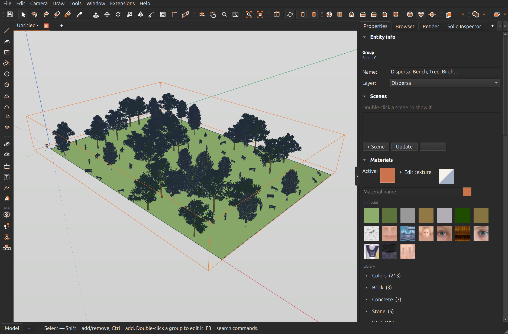
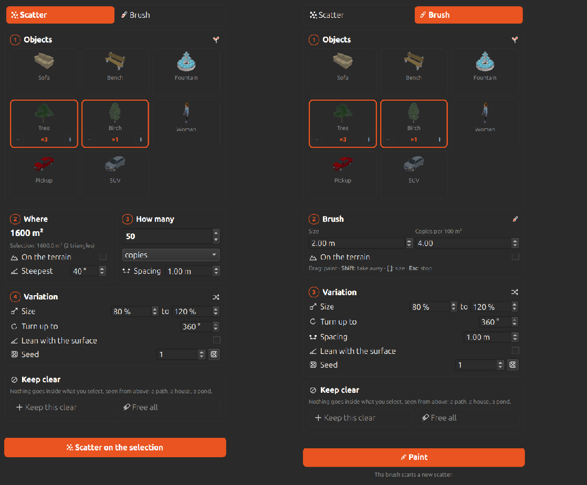

# Dispersa for IngeTrazo

**[English](#english) · [Español](#español)**

An extension for [IngeTrazo](https://github.com/ingelibre/ingetrazo) that
**scatters objects** (trees, plants, stones, people, benches) over faces, a
group or the terrain, with their size and turn at random.



---

## English

### What it does

The tab has two ways, picked at the top: **Scatter** fills the faces you
select, and **Brush** paints copies where you drag. Each way shows only
its own boxes, numbered in the order you use them.



- **Objects:** the components already in your model, and IngeTrazo's own
  (tree, birch, person, bench…), as tiles with their picture. Click
  several and give each a **share** with − and +: a birch at ×3 and a tree
  at ×1 makes three birches for every tree.
- **Surface:** select faces, or a whole group (only its faces that look up
  are used: floors and roofs, not walls). Tick **On the terrain** and the
  copies drop onto the 3D terrain of the Terrain tab, inside the selected
  area: draw the outline of a park, select it, scatter.
- **How many:** a number of copies, or copies per 100 m²; a **least
  distance** between copies, so they do not run into each other.
- **Variation:** size between two percentages, a random turn, and copies
  that **lean with the slope** (stones, grass) or stand upright (trees,
  people).
- **A seed:** the same seed gives the same scatter; the **dice** gives another.
- **Light:** every copy shares its object's geometry, so a thousand trees
  weigh one tree in the file.
- **One group on a layer of its own**, **one undo step**. Select the group
  later and the tab brings back how it was made: change the numbers and
  press **Scatter again** on the same surface.
- **Brush** (0.2): choose **Brush**, press **Paint** and drag over faces, or over the
  terrain with *On the terrain* ticked, and copies appear under the
  brush, with the objects and variation you chose. **Shift+drag** takes
  copies away; **[** and **]** change the brush size; **Esc** stops.
  Each stroke is one undo step and stays in the scatter, so scattering
  again keeps what you painted.
- **Keep clear** (0.2): select a path, a house or a pond and press **Keep
  this clear**: nothing goes inside it, seen from above, now or
  when you scatter again.

### Install

From IngeTrazo's extension manager, or by hand: copy the `dispersa` folder
into IngeTrazo's plugins folder (**Extensions ▸ Open plugins folder**) and
restart IngeTrazo. The **Dispersa** tab appears in the side tray.

Needs IngeTrazo 0.6.0 or later.

### Tests

```bash
INGETRAZO_SRC=~/src/ingetrazo QT_QPA_PLATFORM=offscreen \
    <ingetrazo venv>/bin/python -m pytest tests
```

---

## Español

### Qué hace

La pestaña tiene dos modos, que se eligen arriba: **Repartir** llena las
caras que seleccionas y **Pincel** pinta copias donde arrastras. Cada modo
muestra solo sus cajas, numeradas en el orden en que se usan.

- **Objetos:** los componentes que ya están en tu modelo y los que trae
  IngeTrazo (árbol, abedul, persona, banco…), en mosaico con su imagen.
  Elige varios y dale a cada uno una **proporción** con − y +: un abedul
  en ×3 y un árbol en ×1 da tres abedules por cada árbol.
- **Superficie:** selecciona caras, o un grupo entero (solo se usan sus
  caras que miran hacia arriba: pisos y techos, no muros). Marca **Sobre el
  terreno** y las copias bajan al terreno 3D de la pestaña Terreno, dentro
  del área seleccionada: dibuja el contorno de un parque, selecciónalo,
  reparte.
- **Cuántas:** un número de copias, o copias por 100 m²; una **distancia
  mínima** entre copias, para que no se choquen.
- **Variación:** tamaño entre dos porcentajes, un giro al azar, y copias
  que **se inclinan con la pendiente** (piedras, pasto) o quedan de pie
  (árboles, personas).
- **Una semilla:** la misma semilla da la misma dispersión; el **dado** da
  otra.
- **Liviana:** cada copia comparte la geometría de su objeto, así que mil
  árboles pesan lo que un árbol en el archivo.
- **Un grupo en su propia capa**, **un solo paso de deshacer**. Si luego
  seleccionas el grupo, la pestaña recupera cómo se hizo: cambia los
  valores y pulsa **Volver a repartir** sobre la misma superficie.
- **Pincel** (0.2): elige **Pincel**, pulsa **Pintar** y arrastra sobre caras, o sobre el
  terreno con *Sobre el terreno* marcado, y aparecen copias bajo el
  pincel, con los objetos y la variación que elegiste. **Mayús+arrastrar**
  quita copias; **[** y **]** cambian el tamaño del pincel; **Esc**
  termina. Cada trazo es un paso de deshacer y queda guardado en la
  dispersión, así que al volver a repartir se conserva lo pintado.
- **Zonas libres** (0.2): selecciona un camino, una casa o un estanque y
  pulsa **Dejar libre**: nada cae dentro, visto desde arriba, ni ahora ni
  al volver a repartir.

### Instalar

Desde el gestor de extensiones de IngeTrazo, o a mano: copia la carpeta
`dispersa` en la carpeta de plugins de IngeTrazo (**Extensiones ▸ Abrir
carpeta de plugins**) y reinicia IngeTrazo. La pestaña **Dispersa** aparece
en la bandeja lateral.

Necesita IngeTrazo 0.6.0 o posterior.

---

GPL-3.0-or-later · Victor Crespo ([3dvic.com](https://3dvic.com))
